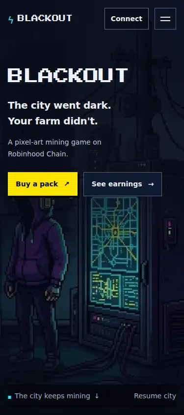
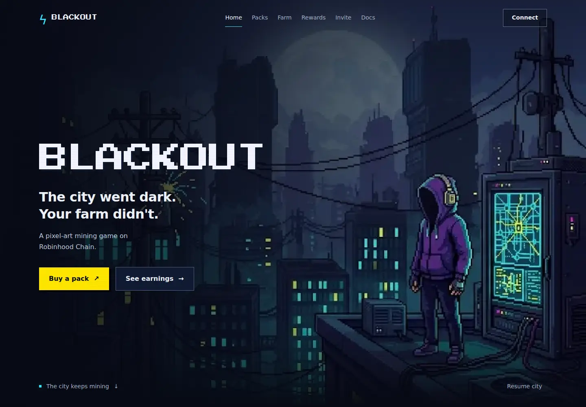
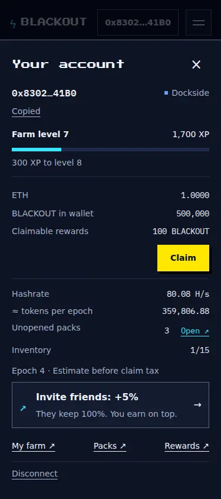
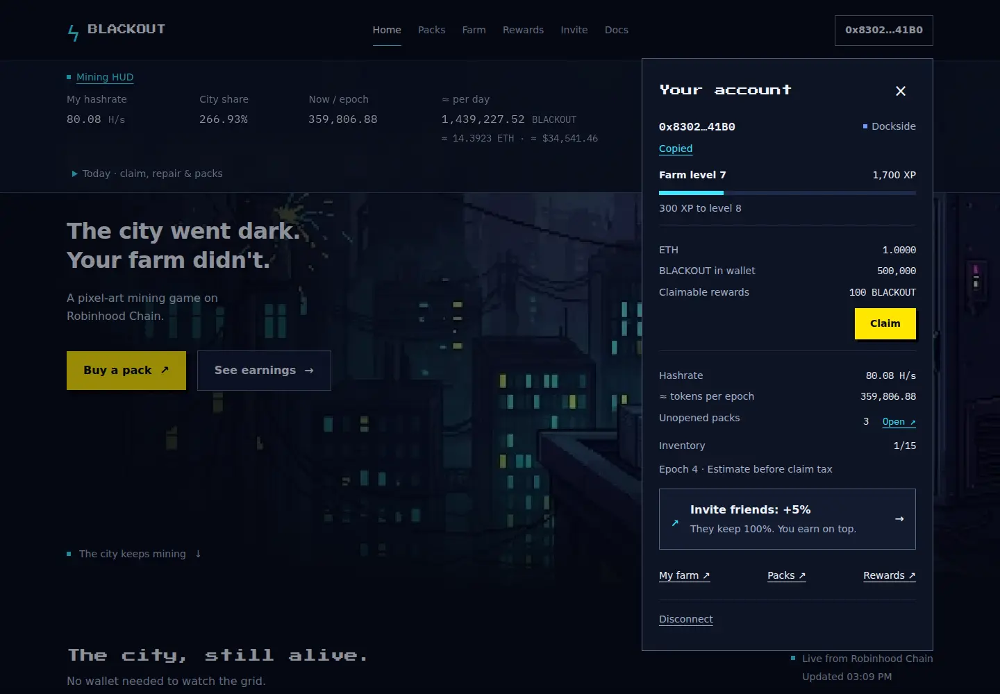
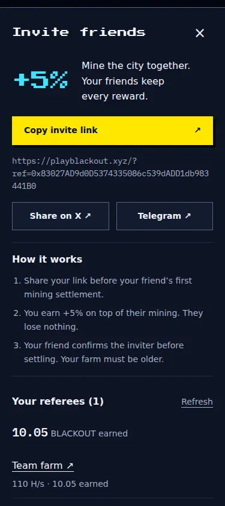
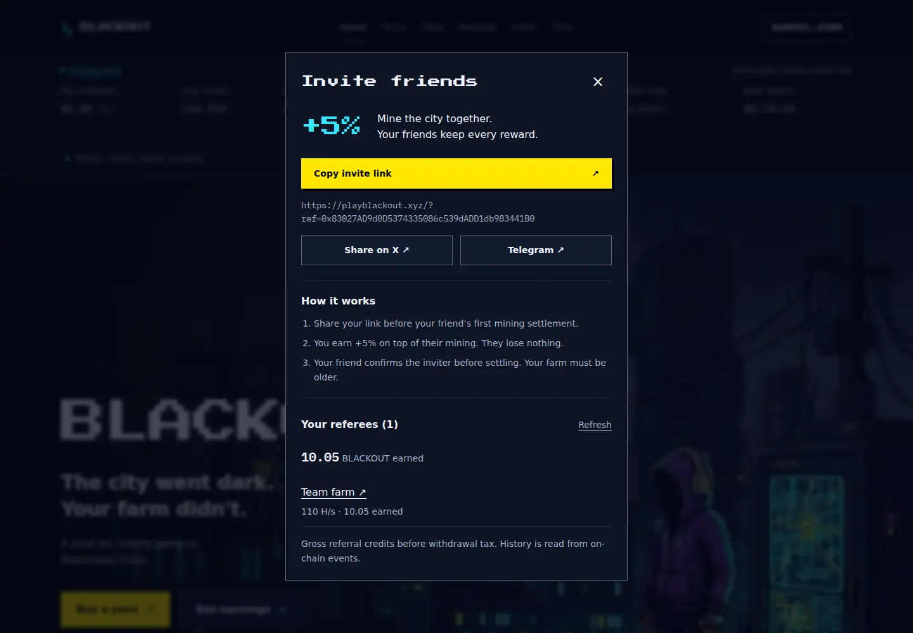
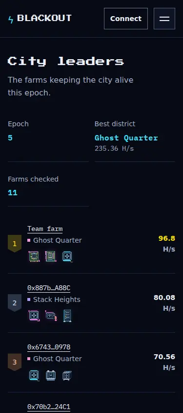
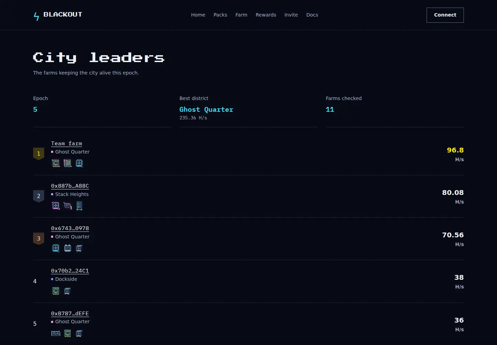

# Stabilize live BLACKOUT updates and expose account/referrals

Home polling replaced entire live panels, resetting their DOM and replaying effects. The live surfaces now patch existing nodes and keyed records in a shared 15-second window, retain data during reconnects and animate only changed numbers. Hero lightning is limited to the sky at 0.06 opacity every 105 seconds, with Pause city and reduced-motion support.

The connected wallet opens a pixel-style account dropdown or mobile bottom sheet. Invite is available in navigation, the account panel, Farm, Rewards and confirmed pack reveals, with copy/share actions, referral attribution and on-chain history. The existing optional referrer and transaction reviews remain.

Home shows the current GridOperator event and three earlier Heralds with clearly labeled flavor quotes. Team farm is identified throughout standings/feed and excluded from the visitor peek. Pack capacity offers “Open N that fit,” prices are consistently formatted, rarity is a labeled badge and leaderboard previews use installed hardware. RPC requests use the supported endpoint, bounded log ranges, small request batches and backoff.

Validation: production build/typecheck; five unit groups; twelve Chromium interaction groups including a MutationObserver across at least two polling cycles; four connection/outage/reflow groups; zero axe violations on account and Invite; pinned design probe 16/16; read-only live chain checks. [Actual results, six-domain review and limitations](validation.md). WebKit lacked system libraries. An independent public-provider session exposed intermittent CORS response headers; the contributor-transport live test does not establish universal public-provider uptime. No deployment or real transaction was performed.

## Required screenshots

**Home and Leaderboard:** live read-only contract data. **Wallet and Invite:** explicit synthetic wallet/RPC fixtures for reproducible connected states; balances, XP and referral earnings in those images are test data. All images are captured from the production export.

| Surface | 375px | 1440px |
| --- | --- | --- |
| Home · live |  |  |
| Wallet · fixture |  |  |
| Invite · fixture |  |  |
| Leaderboard · live |  |  |

## Live detail captures

| Surface | 375px | 1440px |
| --- | --- | --- |
| Home telemetry | [Mobile](screenshots/ux-home-live-375.webp) | [Desktop](screenshots/ux-home-live-1440.webp) |
| Grid Dispatch | [Mobile](screenshots/ux-dispatch-375.webp) | [Desktop](screenshots/ux-dispatch-1440.webp) |

The static delivery is `dist/` alongside source and unchanged dependency manifests/lockfiles. Build/preview instructions are in [README](../README.md), implemented tokens/components in [DESIGN](../DESIGN.md), and submission size in [the bundle report](v14/bundle-trial.json). This file is a prepared PR description; no remote PR or publication was created by this task.
