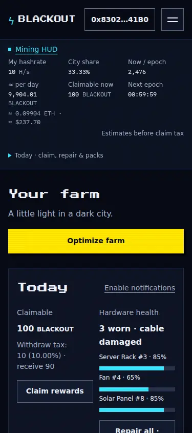
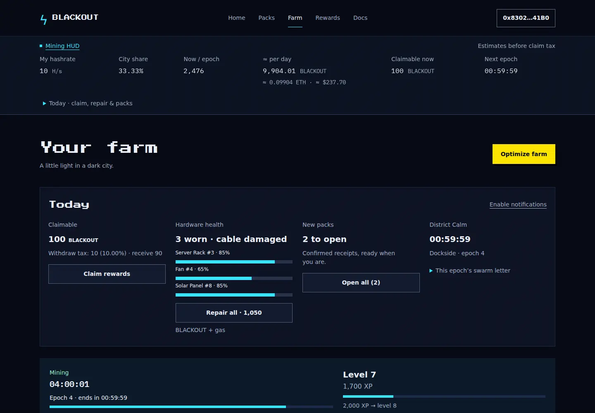
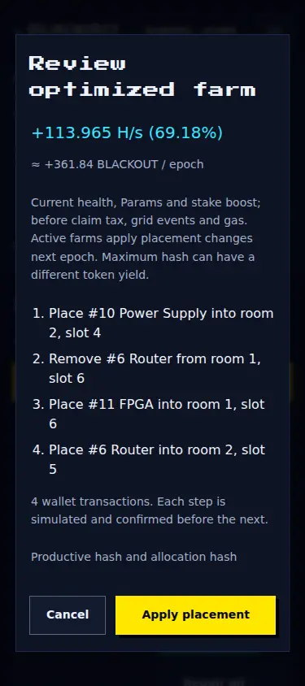
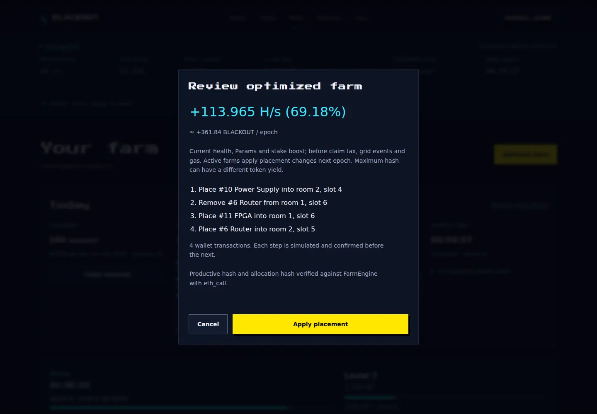
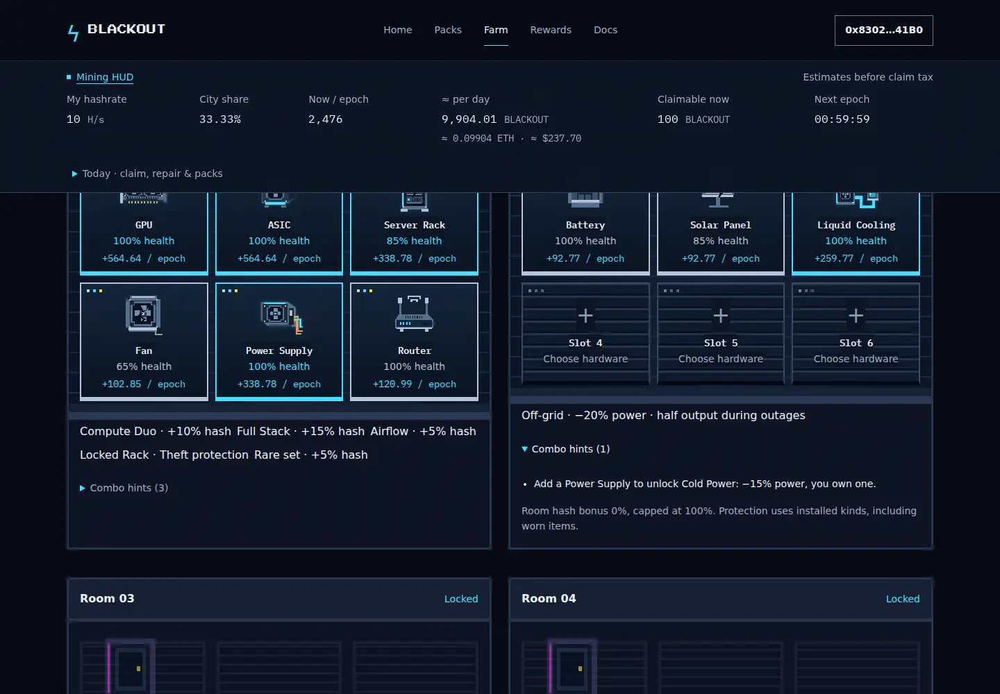

# Add contract-verified farm optimization, referrals and Today

Farm now leads with Optimize farm and a daily action block. Players can review an exact legal placement, see combo gains and apply the shortest reachable move sequence with confirmation progress. The plan mirrors FarmEngine integer math and is checked by eth_call before application. Referral links, eligibility-checked first-action joining, inviter/referee history and gross earned credits are included. Today groups tax-aware claiming, combined item/cable repair, pack opening, epoch/district information and opt-in notices.

Leaderboard previews read installed hardware, numeric decimals use dots, and failing RPC endpoints/log ranges back off without repeated denial requests. Existing visual identity, contract addresses, ABI, dependency lockfiles and build configuration remain intact. `dist/` is regenerated with relative assets.

Validation: production build/typecheck; seven unit groups including 65 exhaustive-oracle farm cases; 13 Chromium interaction groups; zero axe violations on four routes; live parity for 18 candidate layouts/72 room previews and an optimized real farm. The design probe passes 15/16 with the existing BLACKOUT/ETH capitalization exception. See [validation](validation.md) for results, six-domain review and limits.

Screenshots below use synthetic wallet data against the production export; no real funds were signed. WebKit was unavailable. Exact search has exponential worst-case cost and can be canceled. Future token income is an estimate.

## Farm at 375px

## Farm at 1440px

## Optimizer review at 375px and 1440px

## Room combo guidance

This is the review description supplied with the Git submission; no remote PR was opened by the worker.
